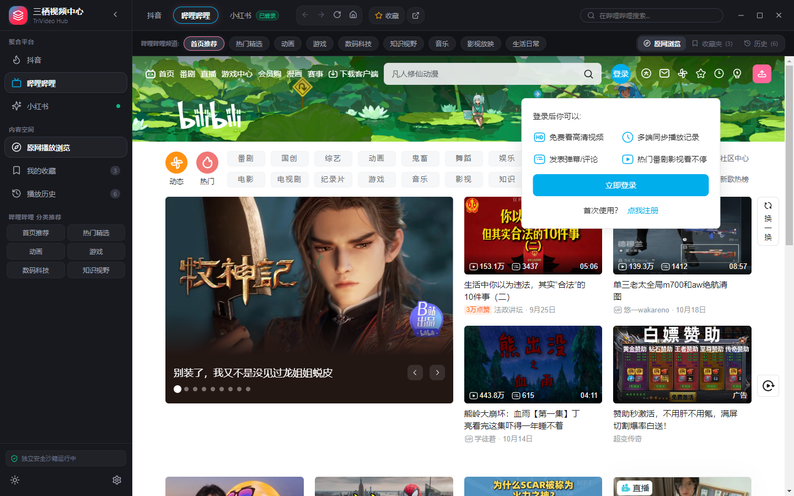
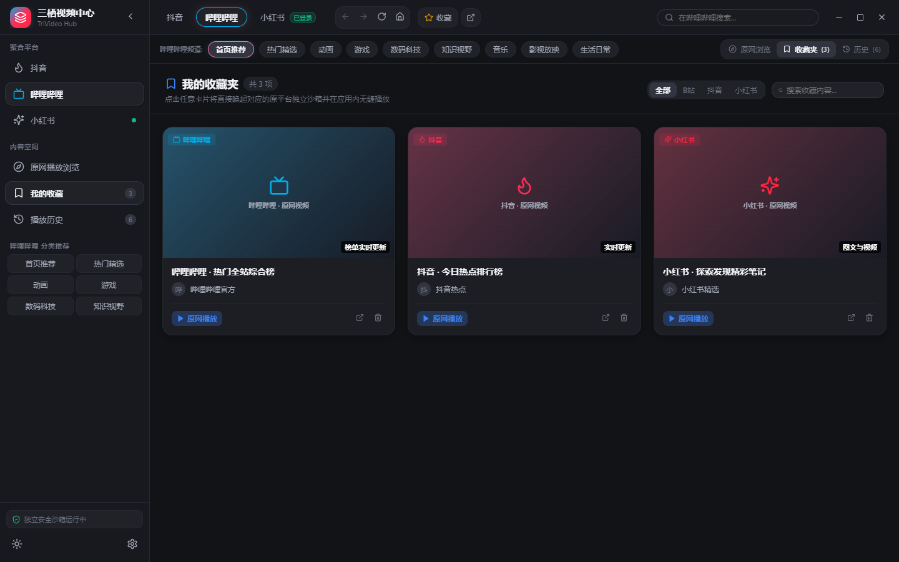
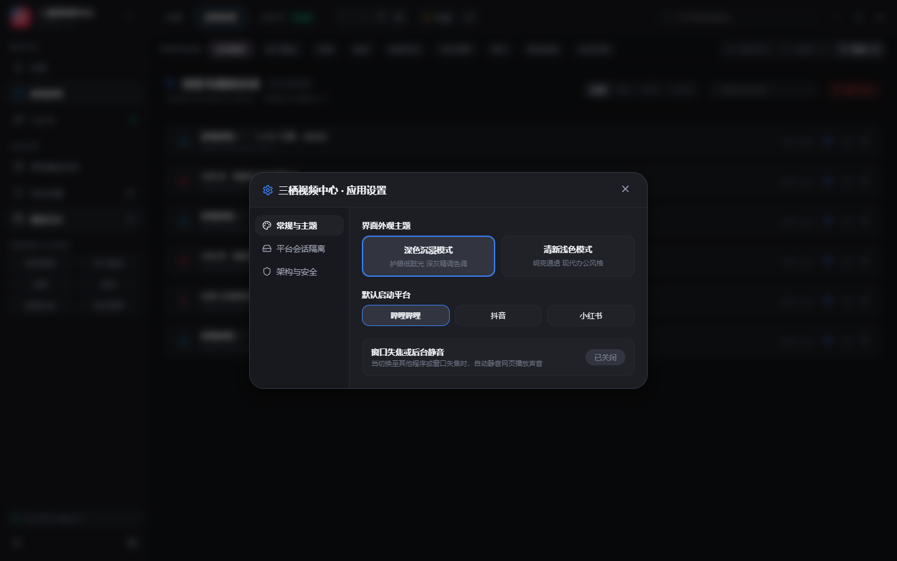

# 三栖视频中心 (TriVideo Hub)

> 一个为 Windows 10/11 打造的现代化三平台（抖音、哔哩哔哩、小红书）短视频与长视频聚合桌面客户端。

[](https://github.com/krantjohn/trivideo/releases)
[](https://github.com/krantjohn/trivideo)
[](https://www.electronjs.org/)
[](https://react.dev/)
[](https://www.typescriptlang.org/)

---

## 📸 运行预览

| 主界面（深色模式） | 主界面（浅色模式） |
| :---: | :---: |
|  |  |

| 精选收藏卡片流 | 应用设置与独立会话管理 |
| :---: | :---: |
|  |  |

---

## 📖 项目简介

**「三栖视频中心 (TriVideo)」** 旨在解决用户在 PC 端反复在网页端或不同应用间切换抖音、哔哩哔哩和小红书的痛点。软件采用本地轻量化架构，为三个平台提供完全独立的沙箱会话与视图渲染，兼具**原平台完整登录/原生播放体验**与**聚合收藏/历史记录/频道直达**能力。

---

## 🌟 核心特性与架构亮点

### 1. 现代化桌面架构（现代 WebContentsView）
- **告别已弃用组件**：全面采用 Electron 官方推荐的现代视图容器 `WebContentsView`，彻底摒弃旧版 `BrowserView`。
- **视图保活与零卡顿**：切换平台时，通过精确计算渲染区域与视口控制，完整保留各平台的播放进度、滚动位置与页面表单状态，切回即看。

### 2. 严格的 Session 独立沙箱与登录持久化
- **独立持久分区**：
  - 抖音：`persist:douyin`
  - 哔哩哔哩：`persist:bilibili`
  - 小红书：`persist:xiaohongshu`
- **Cookie 互不干扰**：各平台 Cookie、Local Storage、IndexedDB 完全隔离，彻底杜绝不同账号体系间的状态污染。
- **登录状态持久保持**：支持应用内扫码或短信登录，关闭软件后重新打开依然保持登录状态。
- **隐私与安全**：绝不拦截、解密或上传用户的登录凭据至任何自建服务器，所有数据仅存储于本地。

### 3. 双模浏览与内容聚合
- **模式 A：原网浏览播放模式**
  - 保留各平台官方原生播放器与完整互动功能（4K/1080P 高码率画质、大会员权限、弹幕、点赞、评论、关注）。
  - 内置导航工具栏：后退、前进、刷新、主页、在外部浏览器打开、一键收藏当前页面。
- **模式 B：精选收藏与历史中心**
  - **4~5 列响应式卡片流**：直观展示视频封面、时长、标题、平台来源标识、UP主/创作者头像与名称、播放量/点赞数。
  - **一键原网直达**：在卡片上点击「原网播放」，立即无缝唤起对应平台的原生沙箱并直达该视频/图文。

### 4. 平台内聚合搜索与智能频道分类
- **精准平台搜索**：顶部右侧搜索框自动锚定当前处于激活状态的平台，回车即可触发该平台的原生搜索。
- **频道快捷入口**：
  - **哔哩哔哩**：首页推荐、热门精选、动画、游戏、数码科技、知识视野、音乐、影视放映、生活日常。
  - **抖音**：精选推荐、热点榜单、直播大厅、娱乐、二次元、知识、游戏、美食。
  - **小红书**：探索发现、穿搭时尚、美食探店、彩妆护肤、影视追剧、职场干货、家居装潢、游戏日常。

### 5. 极致视觉品质与双主题
- **深色沉浸主题**：基于深灰碳黑调（`#121316` / `#1c1e24`）精调，媲美 Spotify 与 Discord 的高级质感，长时间观看护眼防眩光。
- **清新浅色主题**：明亮干净的高级灰白风格，支持一键无缝切换且记住用户偏好。
- **灵活侧边栏**：支持 240px 完整模式与 68px 迷你折叠模式自由切换。

---

## 🛠 技术选型

- **桌面底座**：Electron 33 (Chromium 131)
- **前端视图**：React 18 + TypeScript + Vite 6
- **图标系统**：Lucide React
- **持久化方案**：本地原子写入 JSON 配置数据库 (`trivideo-data.json`)
- **打包分发**：electron-builder (支持 Windows Portable 便携版与 NSIS 安装程序)

---

## 📂 项目结构

```text
trivideo/
├─ package.json                   # 项目依赖与运行脚本
├─ electron-builder.yml           # Windows 打包配置文件
├─ vite.config.ts                 # Vite 渲染进程构建配置
├─ tsconfig.json                  # 渲染进程 TypeScript 配置
├─ tsconfig.main.json             # 主进程与 Preload TypeScript 配置
├─ resources/
│  ├─ icon.ico                    # Windows 高清多分辨率应用图标
│  └─ icon.png                    # 256x256 PNG 图标
├─ screenshots/                   # 真实运行渲染截图
│  ├─ trivideo-main-dark.png      # 主界面（深色模式）
│  ├─ trivideo-favorites-dark.png # 我的收藏（多列卡片流）
│  ├─ trivideo-history-dark.png   # 浏览与播放历史
│  ├─ trivideo-settings-dark.png  # 应用设置与会话隔离中心
│  └─ trivideo-main-light.png     # 主界面（浅色模式）
├─ src/
│  ├─ types/
│  │  └─ index.ts                 # 跨进程类型声明与 ElectronAPI 接口
│  ├─ main/
│  │  ├─ main.ts                  # 主进程入口、单实例锁控制
│  │  ├─ window.ts                # 无边框主窗口创建与生命周期管理
│  │  ├─ platform-config.ts       # 平台配置、分类频道与搜索规则
│  │  ├─ platform-manager.ts      # WebContentsView 现代化视图池调度
│  │  ├─ session-manager.ts       # 平台独立 Session、Cookie 状态与权限安全
│  │  ├─ storage.ts               # 本地收藏、历史与设置原子持久化
│  │  ├─ security.ts              # 协议校验与外部恶意跳转拦截
│  │  └─ ipc-handlers.ts          # 渲染进程 IPC 消息分发注册
│  ├─ preload/
│  │  └─ index.ts                 # contextBridge 最小权限安全隔离注入
│  └─ renderer/
│     ├─ index.html               # 渲染宿主 HTML
│     ├─ main.tsx                 # React 挂载入口
│     ├─ App.tsx                  # 核心响应式布局与控制器
│     ├─ components/
│     │  ├─ Sidebar.tsx           # 左侧可折叠功能侧边栏
│     │  ├─ TopNav.tsx            # 顶部平台切换、导航控制与搜索
│     │  ├─ CategoryBar.tsx       # 频道快捷标签栏
│     │  ├─ SplitView.tsx         # 多屏/分屏视口网格与拖拽分频器
│     │  ├─ OnboardingModal.tsx   # 首次运行平台向导弹窗
│     │  └─ SettingsModal.tsx     # 主题、平台管理、覆盖更新与设置弹窗
│     ├─ services/
│     │  └─ api.ts                # 前端服务层与 Electron IPC 通信网关
│     └─ styles/
│        ├─ variables.css         # CSS 变量设计规范（深色/浅色、色彩系统）
│        ├─ index.css             # 全局滚动条、窗口拖拽及重置样式
│        └─ components.css        # 按钮微交互、卡片悬浮动效
├─ tests/
│  ├─ platform-config.test.js     # 平台配置规范性单元测试
│  ├─ storage.test.js             # 本地持久化与 CRUD 单元测试
│  ├─ security.test.js            # 协议与域名安全拦截单元测试
│  ├─ session-logic.test.js       # 跨平台 Cookie 识别单元测试
│  ├─ edge-cases.test.js          # 异常 JSON、上限容量与特殊字符测试
│  └─ e2e-verify.js               # Electron 端到端启动与真实渲染验证
└─ README.md                      # 项目说明文档
```

---

## 🚀 快速开始

### 1. 环境准备
- 操作系统：Windows 10 / Windows 11 (x64)
- 运行环境：Node.js >= 18 (已在 Node.js v24.19.0 + npm 11.17.0 上完成充分验证)

### 2. 安装依赖
```bash
npm install
```

### 3. 开发模式启动
```bash
npm run dev
```

### 4. 自动化测试
```bash
npm test
```
*内置 14 项覆盖平台配置、存储持久化、会话隔离逻辑、短链路由、页面内导航决策矩阵、安全校验及边缘情况的自动化单元测试。*

### 5. 编译构建
```bash
# 检查 TypeScript 类型
npm run typecheck

# 编译主进程与渲染进程
npm run build
```

### 6. 打包 Windows 应用
```bash
# 生成解包绿色目录 (用于即时运行验证)
npm run pack

# 生成 Windows 便携版单文件可执行程序 (Portable EXE)
npm run dist:portable

# 生成标准 Windows NSIS 安装包
npm run dist
```

---

## 💾 数据存储位置

- **配置文件与收藏/历史**：
  `%APPDATA%\trivideo\trivideo-data.json`
- **各平台独立会话与 Cookie**：
  - 抖音：`%APPDATA%\trivideo\Partitions\douyin`
  - 哔哩哔哩：`%APPDATA%\trivideo\Partitions\bilibili`
  - 小红书：`%APPDATA%\trivideo\Partitions\xiaohongshu`

---

## 🔒 安全合规说明

1. 本软件为纯本地桌面客户端，**不包含任何远程上报代码与自建分析服务**。
2. 遵循 Chromium 严格沙箱机制，渲染进程与主进程采用 `contextBridge` + `ipcRenderer.invoke` 通信，禁用 Node.js 直接集成。
3. 遵循各视频平台的正常网页使用协议，不使用逆向破解或规避验证码的非法手段。
